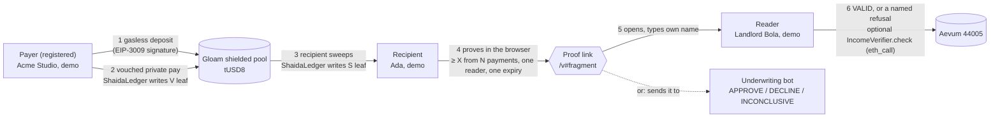

# Shaida

Get paid privately in stablecoins on Aevum Testnet (chain 44005, tUSD8), then prove to a reader you name that registered
payers paid you at least a threshold, without handing over your wallet history. A name-only link binds intent, not
identity: anyone who has it and types the name sees the result. A code-protected link also needs an 80-bit code the
reader made, which is not in the link; it is a shared secret, not a login. <!-- CL36 --> <!-- CL57 -->
Links made since D35 can be revoked by their holder; every verifier then says REVOKED. Older links can't be revoked
and verify as before. <!-- CL56 -->
What stays hidden, and what does not, was measured by attacking the live deployment. Hidden: which receive address was
paid, and single payment amounts unless a note is withdrawn whole. Public by design: which registered payer paid, and
deposits and withdrawals. At today's testnet volume, timing narrows things further ([privacy audit](#privacy-what-the-audit-measured)). <!-- CL30 --> <!-- CL32 -->

**Live app: https://shaida.onrender.com** (Aevum testnet 44005; no login, no wallet needed to verify the example
proof), checked logged out in [evidence/hosting-render.md](evidence/hosting-render.md). <!-- CL43 -->
**Ceremony key:** release [`ceremony-v1`](https://github.com/DrApkFile/Shaida/releases/tag/ceremony-v1), sha256
`cbcb06fe…`, as recorded. <!-- CL34 -->

Based in part on the [Aevum Starter Kit](https://github.com/qday-io/aevum-starter-kit) (MIT, PQA Labs). Private
payments run on [Gloam](https://github.com/gloamtrade/gloam) (MIT), a pinned submodule. Credits: [NOTICE.md](NOTICE.md). <!-- CL01 -->

Judges: [PROOF_PLAN.md](PROOF_PLAN.md) has every run, check and attack in one place. `make eligibility` re-checks
the acceptance gates against the live system, read-only ([evidence/eligibility.md](evidence/eligibility.md)). <!-- CL50 -->

## Status
Every statement in this section maps to a row in [CLAIMS.md](CLAIMS.md). `make gate` fails if a statement has no row,
or cites a row that is not PROVEN. <!-- CL24 -->

**Works today on Aevum testnet (44005):** <!-- CL33 -->
- The stack is deployed: 16 contracts, checked against the chain. 14 of them are verified on the explorer; the other
  two are bytecode-only Poseidon libraries ([evidence/aevum-deployment.md](evidence/aevum-deployment.md)). <!-- CL03 --> <!-- CL39 -->
- **Run 1**, driven by a script through the app's own server routes: a gasless deposit, then three vouched private
  payments (1.5 + 1 + 0.5 tUSD8, demo personas). Then three sweeps, a ≥ 3 tUSD8 proof with the ceremony's final
  key, VALID for "Landlord Bola", `IncomeVerifier.check` true, and an attest on chain. Every tx is linked in
  [evidence/live-44005-run1.md](evidence/live-44005-run1.md). <!-- CL31 --> <!-- CL33 -->
- **Run 2**, clicked by hand by the builder on the live site in Firefox at 390 px: a gasless deposit, three vouched
  payments, one "Sweep all 3", a proof built in the browser in 16.2 s, VALID, the on-chain check and the attest
  ([evidence/live-44005-run2.md](evidence/live-44005-run2.md)). <!-- CL33 -->
- **The underwriting bot**: no LLM, a fixed and versioned policy. On the live site it APPROVEd a proof made out to it
  under `rent-check` and DECLINEd it under `revenue-credit`, with the same decision ids from the local CLI. It then
  recorded the approval on chain with its own key (one attest, 267,053 gas)
  ([evidence/underwrite-live-44005.md](evidence/underwrite-live-44005.md)). <!-- CL47 --> <!-- CL48 -->
- Withdrawals: run 1's three swept notes left the pool in one batch through the live site's `/app/withdraw`, driven
  by a headless browser script. Withdrawals are public and show their amounts, so the app never withdraws by itself. <!-- CL40 -->
- Hosting: Render free plus Upstash Redis. `/api/health` reports origin/master's commit; every proving file is served
  with its pinned sha256. <!-- CL43 -->

**Built and tested (`make test`, `make test-fork`):** <!-- CL17 -->
- Contracts: `PayerRegistry` (register, revoke for good) <!-- CL04 -->, `ShaidaDepositor` (gasless EIP-3009 and
  standard deposit, both through `shieldBound`) <!-- CL05 -->, `ShaidaLedger` (vouch and sweep leaves, one vouch per
  payment, `lateVouch` repair, D9) <!-- CL06 -->, all on Gloam's pool with its final-ceremony verifiers. <!-- CL07 -->
  `IncomeVerifier` checks one proof: tUSD8, a known ledger root, a gas guard, then Groth16. <!-- CL16 -->
- Income circuit: 4 slots per proof, 44,687 constraints <!-- CL08 -->. It refuses cheats X04–X09 and public-signal
  tampering, with property tests <!-- CL11 -->. Bundles of up to 8 proofs cover disjoint ranges (pure witness builder
  <!-- CL09 -->, pure verifier <!-- CL10 -->), and shares are rounded down to whole tUSD8 <!-- CL12 -->. Circuit tests
  use a throwaway key <!-- CL13 -->, which is refused on 44005. <!-- CL15 -->
- Ceremony: contributions by Kene and Gunroar, then a beacon from Aevum block 3772100, verified (ZKey Ok). <!-- CL14 -->
- Indexer (chunked logs, retry, persisted cursor, roots recomputed in the browser) <!-- CL19 --> and relayer (one route
  per contract function, rails before simulation, a gas budget, unknown outcomes never resent) <!-- CL20 -->. In
  production both keep their state in Redis, and a restart never resends a request. <!-- CL42 -->
- Pay, inbox, prove and verify in the browser at 390 px <!-- CL21 --> <!-- CL37 -->. Proofs use the final keys,
  hash-checked <!-- CL22 -->; secrets live in an encrypted browser vault with a backup that restores elsewhere. <!-- CL23 -->
- Acts 2–6 also run on a local fork, by script and through the UI <!-- CL02 --> <!-- CL35 -->. Fork gas figures:
  [evidence/fork-gas.md](evidence/fork-gas.md). <!-- CL17 -->
- The bot's engine, limits and pages: <!-- CL44 --> <!-- CL45 --> <!-- CL46 -->. The quick privacy fixes
  F3, F4, F5, F8 and F9 are applied, and were measured on the fork fixture. <!-- CL49 -->
- `make gate` scans the whole git history for secrets. <!-- CL41 --> Issuer and front-running limits:
  [LIMITS.md](LIMITS.md). <!-- CL18 --> The test count, per suite, is in [evidence/presubmit-audit.md](evidence/presubmit-audit.md). <!-- CL51 -->
- The web app's style follows the builder's Muuve project; no Muuve file is copied. <!-- CL38 -->

**What failed, kept on record:** <!-- CL02 -->
- Three fork runs of acts 2–3 failed, and one of acts 4–6. They found a relayer bug that recorded a mined tx as
  dropped, and a reply that returned another request's record, both fixed in D20
  ([evidence/acts-2-3-fork-FAILED-*](evidence/)). <!-- CL02 -->
- Run 2 found that `/app/prove` reset its form about every 15 s. It was fixed during the run, and that step was
  redone. <!-- CL33 -->
- The first ceremony contribution was made under a placeholder name. It is superseded but kept on record (D15,
  [ceremony/TRANSCRIPT.md](ceremony/TRANSCRIPT.md)). <!-- CL14 -->
- The privacy audit refuted two earlier pitch lines: "reveals nothing else" and "the chain shows only that a
  registered payer paid". Both stay in CLAIMS.md, marked refuted. <!-- CL30 --> <!-- CL32 -->

**Not built:** on-chain bundle checks (one proof per `check`; bundles are verified off-chain), a reader code that
authenticates the reader, a pool of relayer keys, signed bot decisions, optional payer-name disclosure, the privacy
fixes F1, F2, F6, F7 and F10, the SDK's payer side, and mainnet. See
[ROADMAP.md](ROADMAP.md). <!-- not-built -->

## The problem
A freelancer paid in stablecoins who needs to show a landlord they earn enough has two bad options: share a wallet,
which shows every payment, counterparty and balance, or send screenshots, which prove nothing. A lender or sponsor
has the same problem in reverse. They want to know the income is real and recent, without becoming the custodian
of someone's whole financial history.

**Hook:** get paid privately in stablecoins, then prove you earn enough, and show as little else as the chain allows.

## The loop

A vouch leaf V is written only for a payment by an **active registered payer**, and a sweep leaf S only when the
recipient spends that payment into a note that only they can open. The circuit counts a payment only if both leaves
exist. So a payer cannot claw a payment back and still have it count, and a recipient cannot count a payment that no
registered payer made.

## Verify it yourself in 30 seconds
No clone, no wallet, no key. Needs `curl`, `sha256sum` and Foundry's `cast`. Every command is read-only, and each was
pasted into a clean `env -i` shell on 2026-11-25 (results in [evidence/presubmit-audit.md](evidence/presubmit-audit.md)).

```bash
# 1. The live site: its commit, the one chain it serves, its store
curl -s https://shaida.onrender.com/api/health
# → {"ok":true,"commit":"<origin/master>","networks":[{"key":"aevum","chainId":44005}],"store":"redis",...}

# 2. The ceremony's final key: the release asset and the file the live site proves with hash the same
curl -sL https://github.com/DrApkFile/Shaida/releases/download/ceremony-v1/income_final.zkey | sha256sum
curl -s  https://shaida.onrender.com/circuits/income/income_final.zkey | sha256sum
# → cbcb06fecdf72b47bb7d45d4403eaf69cf78bee65ad41cd50d0c98f4609cc0a5  (both; = ceremony/record.json)

# 3. Run 1's proof (the landing page's example), checked by IncomeVerifier on 44005 (eth_call, nothing is sent)
IV=0xc9844a8f058be2d658c972d1d2276b13f308e1c8
SIG='check((uint256[2],uint256[2][2],uint256[2]),uint256[7])(bool)'
PROOF='([14385630210485148173140411729248410929534799000394051281280523826393294070643,4519694375901149672635668455719354965885529312037109444923260616672419860318],[[85327440576977357682093675778706963369604588597144873833054511420100296026,891182396202218595697994059671304611341639066464019200599560573590943568448],[20809376928520476970403090815833402624062691277730368008294798283374109420780,16019635815970228929934320710785908756508522648997810509088724215365138142950]],[274929372000285130921731834805775190835340607782804715978128691083442805553,6245113005045703198770955059173083330897330760135747540580154087395882703875])'
SIGNALS='[9130517190025434358771755680069936142359459316890073609826136462518191825812,396181930009140960553639667353982504061169251459,3000000,3,0,5,2944809414806388594261459639329508787329744203645507645542558885315659230870]'
cast call $IV "$SIG" "$PROOF" "$SIGNALS" --gas-limit 400000 --rpc-url https://rpc-test.qday.info
# → true

# 4. Attack it: claim 30 tUSD8 instead of 3 (public signal 3 of 7)
cast call $IV "$SIG" "$PROOF" "${SIGNALS/,3000000,/,30000000,}" --gas-limit 400000 --rpc-url https://rpc-test.qday.info
# → Error: execution reverted: ProofInvalid
```
The attest that recorded run 1's check on chain, from the reader's wallet, emitting `IncomeProofChecked(threshold
3000000, count 3)`: [0xf8c1b89b… on the explorer](https://explorer-test.qday.info/tx/0xf8c1b89b50c79f2891b254f1ca3b297e1e5bb796af64f292b72a2a28f0645441). <!-- CL31 -->

## The 60-second judge path
All read-only: nothing is sent unless you tick the consent box and press "Record check", and you don't need to.
Personas are demo. The same path, scripted at 390 px: `make judge-ui` ([evidence/judge-ui/](evidence/judge-ui/report-390.md)).

1. Open **https://shaida.onrender.com** and press **See a live proof (Demo)**.
2. Type **Landlord Bola** and press **Verify**. You get **VALID**: at least 3 tUSD8 in 3 payments from registered
   payers, 22 Nov 2026, expiring 22 Dec 2026 (what else a reader can learn: [Privacy](#privacy-what-the-audit-measured)).
3. Press **Check on-chain**: "IncomeVerifier.check passed for 1 proof at block N. Nothing was sent."
4. Attack it:
   - **Another reader:** change the name to `Tenant Chidi` and press Verify. You get **WrongReader**.
   - **Edit the threshold:** paste this into the browser console on the same page, then press Verify. You get
     **ProofInvalid**.
     ```js
     const j=JSON.parse(atob(location.hash.slice(1).replace(/-/g,'+').replace(/_/g,'/')));j.proofs[0].publicSignals[2]="4000000";location.hash=btoa(JSON.stringify(j)).replace(/\+/g,'-').replace(/\//g,'_').replace(/=+$/,'')
     ```
   - **Edit the expiry** (`j.expiry+=2592000` in place of the threshold edit): **ContextMismatch**.
5. The bot: open [the bot with a sample link made out to it](https://shaida.onrender.com/underwrite?preset=rent-check#eyJ2IjoxLCJwcm9vZnMiOlt7InByb29mIjp7InBpX2EiOlsiNTQ4OTg3OTA5OTI4OTI0MjUwMzUyNTA2NjAyOTM5MTA2MzM1MzEwNDE5MjQzNjE5MDczOTI3MjI0ODQ1NDk4Mjk4Mzc3NzcyMzI4NCIsIjE2ODM0ODE4NTc0NzE0MjM2Mzk5MTU5MzAzMjU4MjQ1MzExOTkxNTY0MDIwNDM2NjM0NDg1OTAzNzUwMjM3MDQyOTc2NTYzNzgzMTczIiwiMSJdLCJwaV9iIjpbWyI2NDIyNzg1NDkyNzU2ODM2OTM2MTgzNzM0MzMyNDI2NzQyNzk0ODg5MDEyNDkzNzEwODA5ODQyMzA4MjE5ODM1MTY5OTc5OTIzNzYiLCIxNTk5MDEyNjk4MTUxNDExMDE2ODk1NzMxNzU0NDI4MzQ2NDc3NzU3MzM0Nzk1MDI5MzAxOTQ1NjU1OTU4ODIxNDYzNzk2NjA4MjI2OCJdLFsiMTYxNzMxODgzODY0ODgwODQ3NDY0MTIwODYyMTcyNTEwMDY3OTc5ODUxOTA0MTExODEwMzA5MjM5NzQ0MjI5MjU5Nzg1MzU5ODYyMDUiLCIxNDE1NjY5Mjk0OTgxMzE0MDE0NDA1MTA2MTEzNDgwNjc4NTczOTE3NjQ1MzcyMTIyODUyMDkwNzE5ODQyODg0MDA4NzMxMTA1MzA3NCJdLFsiMSIsIjAiXV0sInBpX2MiOlsiMzcyOTMxMDcwMTQzMDUyNjI1ODQ4MzAwMDE0ODc0OTA4OTMyMDIyNjk5NjQ0MTEwODE5MTIxNjg0NDIyNjcwNjg1NDAwNDM3ODc1MCIsIjEyODY4MDI3MjI4NjA5Nzk0ODkwNTg5MDkwNzYwMDA0NTUxMjI3Mjc0NzQ5MTMxMDk0OTA3Mzk2MTQ0Njk5NTE1MjY1MTM2NjY1MDMyIiwiMSJdLCJwcm90b2NvbCI6Imdyb3RoMTYiLCJjdXJ2ZSI6ImJuMTI4In0sInB1YmxpY1NpZ25hbHMiOlsiMTY2MjI0NjI2MjgxOTUxNDE3NzY1MDEyMjYxODQ3ODI4MjM2ODQwMjYxMDk3NTgxODkzODc5NDgyMzk5Mjg4NTY3Mzc1ODcxNzM4NiIsIjM5NjE4MTkzMDAwOTE0MDk2MDU1MzYzOTY2NzM1Mzk4MjUwNDA2MTE2OTI1MTQ1OSIsIjEwMDAwMDAiLCIzIiwiNiIsIjExIiwiMTU2MTY3OTMxNDIxMjU4MzcyMTQwNTU1ODQxMTgyNDkzNzY4OTkyODY4MTQ0MzgyMTY5MTI3NDQ5NzM5NjEyMjQyMTkxNTg2NDkzMzgiXX1dLCJyZWFkZXJJZEhhc2giOiIxMTQwNjY5ODE1OTQzOTI5NzYxOTA0NzUzNTU5OTI5MDQ5OTQxMTA4NzcyODk0MDU0MTQ2ODQyMzc1OTc1MzMxNjY3MDUxNTc3MDM5MiIsImV4cGlyeSI6IjE3OTgxNTMxOTkiLCJzYWx0IjoiMTk4MTMxMDU1NDkwNzYyNDM0NDQ1MjI0Mzk3ODQzNDEyNTc5ODM3NDE1NzIwNTUxNTk1OTUzODkwODc2Mjg5MzUxNDE0NTI5OTAifQ) and press **Ask the bot**. You get
   **APPROVE** under `rent-check`. Pick `revenue-credit` and ask again: **DECLINE**, with BelowMinThreshold,
   TooFewPayments and PeriodTooShort. A link made out to Bola gives **WrongReader**. The sample's APPROVE holds
   until about 17 Dec 2026 23:00 UTC, when fewer than 7 days are left on it (ExpiresTooSoon, by design: LIMITS.md).
6. Revocation and reader codes (D35, D36):
   - Run 1's VALID from step 2 says **Name only: anyone with this link and the name can view it** and **Not
     revocable (made before revocation existed)**: it predates both, and still verifies exactly as before.
   - On **https://shaida.onrender.com/v**, press **Get a code to give the person proving to you**. A reader gives
     this code to the person proving; their link then needs the name and the code ("Code-protected"). Shown once,
     made in your browser, sent nowhere. Press "Done, hide it".
   - The live revoke: Ada (demo) revoked a code-protected link made for Landlord Bola, and Bola's page said
     **REVOKED** ([the live check](evidence/revoke-live-44005.md), with screenshots). On chain, nothing sent:
     ```bash
     cast call 0x3b19c8f3e2f65030ccddebec776c3be32090f2e4 "revokedAt(uint256)(uint256)" \
       0x2c4e9e589f75d055e66379448132eb16963d94dbf4ab45d711d2e6488757df60 --rpc-url https://rpc-test.qday.info
     # → 4139250  (the block of the revoke tx 0x920fd1f6…, sent by the relayer)
     ```
     That link is not published: opening it needs Bola's code. <!-- CL56 --> <!-- CL57 -->

## How it works
**Boundary:** there is no AI. Shaida proves a lower bound on vouched, swept income to a named reader, and nothing
about identity. The bot applies a fixed, versioned policy to a verified proof. It never holds the recipient's keys
or note secrets, and it sees a link only when its holder sends it, for one decision. Everything settles on Aevum
testnet 44005 in tUSD8. Gloam is the pool; Shaida adds the ledger, the circuit, the verifier and the app.

| Guarantee | How | File |
|---|---|---|
| Only a registered, active payer creates countable income | `vouchedPay` writes V = Poseidon(1, payerId, Cp) only for `activeIdOf(msg.sender)`; relayed calls need the payer's EIP-712 signature | `contracts/src/ShaidaLedger.sol`, `contracts/src/PayerRegistry.sol` |
| A payer cannot claw back and still count | the circuit needs S = Poseidon(2, N, Cs), written only by `sweep`, and opening Cs needs the recipient's secret | `packages/shaida-proofs/circuits/income.circom` (X08, X09) |
| No payment is counted twice | at most one V leaf per commitment; V indices strictly increase within a proof; bundles need disjoint ranges | `ShaidaLedger.sol` (D9), `income.circom` (X04), `packages/shaida-proofs/src/verify/` (X14, X15) |
| A link works for one reader and one expiry | `context = Poseidon(readerIdHash, expiry, salt)` is a public signal; the verifier checks reader, expiry and context | `packages/shaida-proofs/src/verify/verify.ts` (WrongReader, ProofExpired, ContextMismatch) |
| Edited numbers fail | Groth16 over the ceremony's final key; on chain, `IncomeVerifier.check` reverts (never returns false) and refuses short gas | `contracts/src/IncomeVerifier.sol` (ProofInvalid, InsufficientGas) |
| A proof is over the real ledger | the root must pass `ShaidaLedger.isKnownRoot`; the browser recomputes the roots from chain events | `IncomeVerifier.sol`, `packages/shaida-index` (UnknownRoot) |
| Proofs never reach the server | the proof rides in the URL fragment; `/v` verifies in the browser (the bot is the one stated exception, D30) | `web/src/app/v/page.tsx` |
| The relayer cannot be made to send anything else | one route per contract function, no calldata or target taken; rails before simulation; gas budget | `packages/shaida-relay`, `web/src/app/api/relay/` |
| A crash never double-sends | the record is claimed in Redis before `sendRawTransaction`; `unknown` has no resend edge | `packages/shaida-relay/src/store-kv.ts` (R12, R23–R27) |
| The setup is not forgeable by one party | Hermez phase 1, then two named contributors and a public Aevum block beacon; Gloam's final keys only | `ceremony/record.json`, `contracts/script/DeployChecks.sol` |

Pages: `/` landing, `/app` dashboard, `/app/pay`, `/app/inbox`, `/app/prove`, `/app/shared`, `/app/withdraw`,
`/v` verify, `/underwrite` bot. APIs: `/api/health`, `/api/index`, `/api/relay/<fn>`, `/api/underwrite`, plus
`/llms.txt` and `/.well-known/agent.json` for agents. Architecture in full: [PRD.md](PRD.md) §3.

## Engineering decisions and the hard problems
- **The ceremony** (D4, D14, D15, D24). The income circuit got its own Groth16 phase 2: the Hermez 2^17 ptau (hash
  checked), contributions by Kene and Gunroar, and a beacon from an Aevum block announced in a commit before it was
  mined. Contribution hashes come from snarkjs as values, not scraped output. A contribution made under a placeholder
  name was superseded and kept on record. The deploy refuses a verifier that rejects a final-key proof or accepts a
  throwaway one.
- **Only swept payments count** (D3, D9). A payer knows the payment note's secret and could spend it back, so a
  payment counts only with a sweep leaf for a note the payer cannot open. Vouches and sweeps are leaves in Shaida's
  own Poseidon tree, proven in the circuit, so the reader never sees commitments.
- **Front-running and `lateVouch`** (D9). Gloam's pool takes `transfer` from anyone, so a copied `vouchedPay` can
  land without its vouch. `lateVouch` lets the payer repair that, once per commitment. A copied sweep is not
  repairable on purpose: a repair would let anyone fake swept income (LIMITS.md).
- **The snarkjs gas trap** (D14). Generated verifiers return `false` when short of gas, and `eth_estimateGas`
  under-reports (~30k against ~258k). `IncomeVerifier` reverts instead of returning false, refuses to start with
  less than 320,000 gas left (`InsufficientGas`), and callers set 400k or 420k explicitly.
- **Restart-safe relaying** (D19, D20, D29). Each request is claimed atomically in Redis (a Lua compare-and-set)
  before the tx is sent. A send with no answer is `TxOutcomeUnknown` and is settled by receipt or by the nonce
  passing it, never re-sent. The first fork runs found two bugs here; both are fixed and covered by tests.
- **Aevum's limits** (CLAUDE.md, REALITY_SPIKES). The chain runs Shanghai only: every artifact is opcode-checked.
  Txs are legacy, log reads are capped at 1,000 blocks, there is no WebSocket, and a day is about 85,000 blocks. So
  the indexer pages logs, keeps a cursor and never rescans from the deploy block.
- **The privacy audit** (D32). We attacked our own live deployment as an observer and as a reader, scored the results
  against ground truth, rewrote the pitch to match, and shipped the quick fixes F3, F4, F5, F8 and F9.

## Real, simplified, not built
| | Item |
|---|---|
| **Real** | contracts on 44005; Gloam's pool with its final keys; the income circuit with a two-contributor ceremony; browser proving; the relayer paying gas on 44005; two end-to-end runs; the bot's decisions and its one on-chain record; the hosted site |
| **Simplified** | the payer registry has one attestor (the builder), and a malicious attestor is not defended (PRD §8); a reader name or code is not a login (D36); one relayer key; Render free, kept awake by a 5-minute monitor (uptime over time is not measured); the bot's presets are demos for one reader name |
| **Demo data** | Acme Studio, Ada, Landlord Bola, Tenant Chidi and the bot's reader name are demo personas, labelled "demo" in the UI and the evidence. The amounts are real testnet tUSD8 |
| **Not built** | on-chain bundles, reader authentication beyond a shared code, codes for the bot, a relayer key pool, signed bot decisions, payer-name disclosure, F1/F2/F6/F7/F10, mainnet ([ROADMAP.md](ROADMAP.md)) |

## Privacy: what the audit measured
Measured by attacking the live deployment (every 44005 transaction to block 3961095) and a fork fixture with known
ground truth: [evidence/privacy-audit.md](evidence/privacy-audit.md), tools `tools/privacy-observer.mjs` and
`tools/privacy-reader.mjs`, and a plain-words list in [LIMITS.md](LIMITS.md). Fixes: DECISIONS D32 (F3, F4, F5, F8
and F9 applied 2026-11-25, app only). The live numbers below were measured before those fixes.

| | Anyone with the explorer (CL32) | A reader holding the link (CL30) |
|---|---|---|
| Which payer paid | **learns it** (payer id, address and signature in every pay, 6 of 6) | **learns it** (payer ids in the range) |
| Total received | **learned it** on 44005 from deposits and on-chain records (4 tUSD8 exactly). Recording is now opt-in behind a warning (F3); without records, the fork fixture shows no attested total at all | **learns it** when the payer's deposits pin it (3 tUSD8 exactly, run 1); otherwise a range |
| Each payment's amount | **learns it** if a whole swept note is withdrawn (3 of 3 on 44005). With the optional split sweep (F4), a withdrawal is only a part (0 of 1 on the fork) | only a bound |
| Which sweep is whose payment | the nullifier hides it, but timing gave it away (6 of 6 on 44005, 6 of 8 on the fork) | the times of every payment and sweep in the range |
| Receive address paid | not learned (sealed memos show only a fixed header) | not learned |
| Amount from gas | not learned (≤ 60 gas apart across amounts) | — |
| Maker's time zone | — | old browser links showed it (UTC+1); new links end at 23:59:59 UTC (F8) |
| Whom the link is for | — | the name confirms it on a name-only link; on a code-protected link (D36) the name alone confirms nothing (fork) <!-- CL58 --> |
| A revocation (D35) | a `revoke` sent by the relayer, tied to no payment or holder without the link (fork) | its block and time: the page says REVOKED <!-- CL58 --> |

Today the pool has one payer and one recipient, so several "not learned" rows hold only because nothing else happens
in it. The suggested threshold is now rounded down and is never the exact total (F9). Choosing the maximum still
tells the reader the total to within one step.

## Known limits → next steps
| Limit (LIMITS.md) | Next step (ROADMAP.md) |
|---|---|
| The payer of every payment is public | F2: a zero-knowledge "registered payer" vouch, worth it only once there are many payers |
| A reader name, and even a reader code (D36), is not a login | a reader key pair and a signed challenge |
| Revocation acts from its block on: an attest stays a historical record, a dishonest RPC can hide it (D35) | — (by design; LIMITS.md) |
| Timing links sweeps to payments at low volume | F6: batched, delayed sweeps, which help once other users share the window |
| One proof per on-chain check | `IncomeVerifier.checkBundle` with the §5 bundle rules on chain |
| tUSD8's issuer can pause or blacklist (S9) | a trust assumption: the app names it (`TokenPaused`, `PayerBlacklisted`) before any signature |
| The bot's APPROVE says "this proof meets the policy", not "this applicant earns this"; the bot is name-only | a reader code per lender for the bot, plus signed decisions |

## Critical path in two minutes
| Question | File |
|---|---|
| What exactly does the circuit prove? | `packages/shaida-proofs/circuits/income.circom` (PRD §3) |
| Who can write a vouch or a sweep leaf? | `contracts/src/ShaidaLedger.sol` |
| What does the on-chain check add to the pairing? | `contracts/src/IncomeVerifier.sol` |
| What does the reader's browser check, and in what order? | `packages/shaida-proofs/src/verify/verify.ts` (PRD §5) |
| How is a period split across proofs? | `packages/shaida-proofs/src/witness.ts`, `split` tests |
| How does the relayer avoid sending twice? | `packages/shaida-relay/src/submit.ts`, `store-kv.ts` |
| How does the indexer read Aevum's logs? | `packages/shaida-index/src/` |
| How does the bot decide? | `packages/shaida-underwrite/src/` and `config/underwrite-policies.json` |
| Was the ceremony done right? | `ceremony/TRANSCRIPT.md`, `ceremony/record.json` |
| What is deployed, from which commit? | `deployments/aevum.json`, `evidence/aevum-deployment.md` |
| Every claim and its evidence | `CLAIMS.md` |

## Tech
Solidity 0.8.24 (Shanghai), Foundry; circom 2.2.3 and snarkjs 0.7.6 (Groth16, bn128); Gloam contracts and
`@gloamtrade/sdk` 0.8.0; Next.js 16.4.6, React 19, wagmi, viem, RainbowKit; zod; Upstash Redis; Render; Node 24.
Aevum testnet 44005 with tUSD8 `0x456569838f1d43009A91ebA4263147Afd7233483` (EIP-3009 for gasless deposits).
Packages: `@shaida/proofs` (circuit, witness builder, verifier: reusable), `@shaida/relay`, `@shaida/index`,
`@shaida/pay`, `@shaida/underwrite`, `@shaida/kv`.

## For integrators
Another app can verify a Shaida link without this website or its server, talking only to the Aevum RPC:
- [`shaida-sdk`](packages/sdk/README.md) (0.2.0, verify side) has a 5-line quickstart, the API reference, the
  closed codes and the trust model. It provides `verifyIncomeLink`, `decodeIncomeLink`, `checkOnChain`, and
  `underwrite` with the two presets or your own policy. <!-- CL53 -->
- 0.2.0 adds `readerCode` for code-protected links and `ProofRevoked`, and checks every link against the
  Revocations registry; 0.1.0 calls keep working (the SDK README's "Upgrading from 0.1.0"). <!-- CL56 --> <!-- CL57 -->
- On npm: [`shaida-sdk@0.2.0`](https://www.npmjs.com/package/shaida-sdk/v/0.2.0), `npm install shaida-sdk`. A clean
  install from the registry runs the Node example on 44005
  ([0.2.0](evidence/sdk/npm-install-0.2.0.md), [0.1.0](evidence/sdk/npm-install-0.1.0.md)). <!-- CL59 --> <!-- CL55 -->
- [examples/verify-node.mjs](examples/verify-node.mjs) (Node, 13 lines) and
  [examples/rental-check/](examples/rental-check/) (a demo landlord page, in the browser). Both are checked against
  run 1 on 44005 and against the fork fixture. <!-- CL54 -->
- For agents that prefer HTTP: [`/llms.txt`](https://shaida.onrender.com/llms.txt) and the bot (below).

## For agents
The underwriting bot is an API with a published contract:
- `GET /llms.txt`: what Shaida is and how to call the bot, in plain text.
- `GET /.well-known/agent.json`: request and response schemas, presets with their limits and policy hashes, the
  closed codes, the rate limit, and whether on-chain recording is on.
- `POST /api/underwrite` with `{"link": "<proof link>", "preset": "rent-check", "record": false}` returns the
  decision. The same link and policy version give the same `decisionId`.
- To keep a link off any server, run the same engine locally:
  `pnpm --filter @shaida/underwrite decide --preset rent-check --link '<link>'`.

## Aevum testnet contracts (chain 44005)
Deployed from commit `2a10759`, and checked against the chain in [evidence/aevum-deployment.md](evidence/aevum-deployment.md),
which lists all 16 addresses with each verified source's SPDX line. <!-- CL03 --> <!-- CL39 --> Revocations (D35) was
added on its own on 2026-11-26 from commit `67993b7`, over the same PoseidonT3; nothing else was redeployed
([evidence/revocations-44005.md](evidence/revocations-44005.md)). <!-- CL56 -->

| Contract | Address | Explorer |
|---|---|---|
| ShieldPoolPoseidon (Gloam) | [`0x0d93a398de615c92b04961dd042471fea4b7eac6`](https://explorer-test.qday.info/address/0x0d93a398de615c92b04961dd042471fea4b7eac6?tab=contract) | verified |
| ShaidaLedger | [`0x677659b068278103f83eff413080cb53be3388ed`](https://explorer-test.qday.info/address/0x677659b068278103f83eff413080cb53be3388ed?tab=contract) | verified |
| ShaidaDepositor | [`0x6a6045a64ae911744fcd63b3186277f8958db2ec`](https://explorer-test.qday.info/address/0x6a6045a64ae911744fcd63b3186277f8958db2ec?tab=contract) | verified |
| PayerRegistry | [`0xce43b77adc82db336d07f03bd84c3834fd9c5215`](https://explorer-test.qday.info/address/0xce43b77adc82db336d07f03bd84c3834fd9c5215?tab=contract) | verified |
| GloamPayMemo (Gloam) | [`0xe2f7c6310e5ccb87fde4ff887b100236960c4e17`](https://explorer-test.qday.info/address/0xe2f7c6310e5ccb87fde4ff887b100236960c4e17?tab=contract) | verified |
| IncomeVerifier | [`0xc9844a8f058be2d658c972d1d2276b13f308e1c8`](https://explorer-test.qday.info/address/0xc9844a8f058be2d658c972d1d2276b13f308e1c8?tab=contract) | verified |
| IncomeGroth16Verifier | [`0xbb79e350e0c27b97f6512173ec7e4dd82bf632af`](https://explorer-test.qday.info/address/0xbb79e350e0c27b97f6512173ec7e4dd82bf632af?tab=contract) | verified |
| DualProofVerifier (Gloam) | [`0xd791178ec6a80ac2fcfeb2a236c427d5a818b57c`](https://explorer-test.qday.info/address/0xd791178ec6a80ac2fcfeb2a236c427d5a818b57c?tab=contract) | verified |
| ShieldVerifierFinal / ShieldIVerifierFinal (Gloam) | [`0x6c15d7cc7f05d8fb8fceab9bd7e92c753abe13e7`](https://explorer-test.qday.info/address/0x6c15d7cc7f05d8fb8fceab9bd7e92c753abe13e7?tab=contract) | verified (adapter `0x6f82…b446` too) |
| UnshieldVerifierFinal / UnshieldIVerifierFinal (Gloam) | [`0xa25b573404fe423aeb005c9539c79d806199a1f5`](https://explorer-test.qday.info/address/0xa25b573404fe423aeb005c9539c79d806199a1f5?tab=contract) | verified (adapter `0xa63d…e843` too) |
| TransferVerifierFinal / TransferIVerifierFinal (Gloam) | [`0xf220726b8f177e7347d6b58f0b14b2380a572cda`](https://explorer-test.qday.info/address/0xf220726b8f177e7347d6b58f0b14b2380a572cda?tab=contract) | verified (adapter `0xfe33…5708` too) |
| Revocations | [`0x3b19c8f3e2f65030ccddebec776c3be32090f2e4`](https://explorer-test.qday.info/address/0x3b19c8f3e2f65030ccddebec776c3be32090f2e4?tab=contract) | verified |
| PoseidonT3 / PoseidonT4 | [`0x1e771073ac7703772c3717650ca0577e103dfaaf`](https://explorer-test.qday.info/address/0x1e771073ac7703772c3717650ca0577e103dfaaf?tab=contract) | bytecode only (circomlibjs, no source); T4 `0xc7aa…ec69` |

## Setup and commands
Needs: git, Node 24.19.0 with pnpm (from `packageManager`), Foundry, circom 2.2.3, and gitleaks 8.21.2 for the gate.
```bash
git clone --recurse-submodules https://github.com/DrApkFile/Shaida.git && cd Shaida
make install      # submodules + pnpm (frozen lockfile) + Gloam's sha256-pinned proving files
make build        # forge build + Shanghai opcode check (ours and Gloam's) + income circuit compile (circom 2.2.3)
make test         # unit tests: contracts, circuit, witness builder, indexer, relayer, pay flows, ceremony, bot, privacy audit
make gate         # BUILD_CONTRACT gate in a fresh clone of HEAD (GATE_IN_PLACE=1 to run in this tree)
make eligibility  # read-only: acceptance gates A01–A12 and the live guards against GitHub, the live site and 44005
make judge-ui     # read-only: the judge path on the live site in headless Chromium (WIDTH=390)
make test-fork    # tests against the real tUSD8 (needs https://rpc-test.qday.info)
make fork         # local Aevum fork, chain 440050 on 127.0.0.1:8555
make deploy-fork  # deploy the stack to the fork; writes deployments/fork.json
make dev          # the web app on http://localhost:3000
make verify-aevum # read-only: check deployments/aevum.json against the chain and the explorer
make secrets      # gitleaks over the git history and uncommitted changes
make deploy-aevum ACCOUNT=<keystore> ATTESTOR=0x...   # real deploy (clean committed tree only); writes deployments/aevum.json
make test-groth16 PTAU_PATH=<Hermez 2^17 ptau>         # full Groth16 proofs with a throwaway local key
```
Environment variables for hosting: [DEPLOY_RENDER.md](DEPLOY_RENDER.md). Design system: [DESIGN.md](DESIGN.md).
Decisions: [DECISIONS.md](DECISIONS.md). Threats: PRD §8 and [THREAT_MODEL.md](THREAT_MODEL.md).

Licence: MIT for Shaida's code. snarkjs-generated verifiers and the circuit that includes circomlib are GPL-3.0,
listed per file in [NOTICE.md](NOTICE.md).
